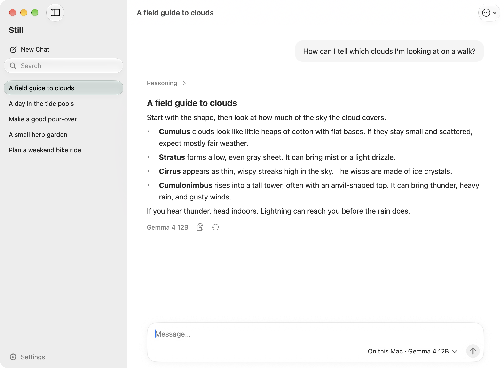

# Still

A small native macOS chat app, with two curated models running entirely on this Mac: **Inkling 2 Mini** and **Gemma 4 12B**. SwiftUI provides the window and conversations; AppKit provides the composer.

<picture>
  <source media="(prefers-color-scheme: dark)" srcset="docs/screenshots/conversation-dark.png">
  
</picture>

## Project layout

The project lives at `/Users/wayne/workspace/still`.

- `Sources/`: native app and shared chat/backend code.
- `Resources/`: local model adapters, generation loop, parsers and pinned dependencies.
- `Tests/`: Swift and Python tests.
- `Scripts/`: build and dependency-install commands.
- `Benchmarks/`: reproducible comparisons, recorded results and diagnostic evidence.
- `dist/`: built `Still.app` and `Still.zip`; excluded from version control.

The installed application is `/Applications/Still.app`. Model weights, Python
environments and saved conversations live in the locations listed below.

## Use

Open Still from Applications. Choose a model from the menu at the upper right, then send a message. Models start on demand. Each conversation remembers its local model choice, and replies retain the name of the model that wrote them.

- Return sends; Shift-Return adds a newline.
- ⌘N starts a chat; ⌘. stops a reply; ⇧⌘R retries the last reply.
- Right-click a conversation to rename or delete it.
- Reasoning is collapsed above each answer. Expand it to read or select the text. Copy on an answer copies only the answer.
- Chats, drafts and reasoning save on this Mac. Older chats without reasoning still open.
- You can type while chat history opens or a model replies. The composer shows when it can send and offers Stop during a reply.
- Scroll up to read earlier text during a reply. Use the down arrow to jump back to the latest message.

Only one model runs at a time. Switching stops the previous process; the next send waits for that process to exit before starting another. Stop terminates the owned process and preserves any partial answer and reasoning. The model also unloads after five minutes idle or when the app quits.

This version supports text chat, Markdown headings/lists/quotes, inline formatting and fenced code blocks. Attachments and tool execution are not implemented. A custom compatible-server connection remains available in Settings, but the curated choices require no accounts or external inference service.

## Architecture

```text
Native chat interface
        │  OpenAI-compatible HTTP + SSE on loopback
Still local_server.py
        │  validation, limits, streaming, errors, lifecycle
Still generation.py
        │  prompt prefill, pipelined decode, stopping, text streaming
        ├─ InklingEngine → MLX-LM model/loader/cache/tokenizer/sampler → MLX
        └─ GemmaEngine   → Still Gemma text model → MLX
```

**Still owns the server and generation loop.** Inkling uses MLX-LM for its model and helpers. Gemma runs the text model bundled in `Resources/still_gemma/`. It uses MLX for tensor operations, Tokenizers for the checkpoint vocabulary, and Jinja2 for its official chat template. The standalone Gemma environment has no MLX-LM or MLX-VLM dependency. The extracted code's [provenance and licenses](Resources/still_gemma/PROVENANCE.md) are bundled with the app.

`StillCore/Backend.swift` sends ordinary role/content messages and optional assistant `reasoning_content`. It accumulates separate answer/reasoning updates; it contains no model-specific token parsing. The shared local API supports `/v1/chat/completions` (streaming and nonstreaming), `/v1/models`, and `/still/health`. It accepts text chat and an output limit via `max_completion_tokens` or `max_tokens`; sampling settings come from the selected curated profile.

`Resources/local_server.py` owns the HTTP boundary and validates requests before generation. `model_engines.py` owns model loading, chat templates, sampling settings and cache policy. `generation.py` processes prompts in chunks of 512 tokens and schedules one GPU decode step ahead of CPU text handling. It checks stop tokens, flushes the detokenizer and restores Metal's working-set allowance when the stream completes or closes. `inkling_protocol.py` and `gemma_protocol.py` translate their respective control markers to `content` and `reasoning_content`. The parent watchdog exits if Still crashes. Python bytecode caching is disabled inside the signed app.

## Model profiles

| Model | Engine | Prompt / total budget | Defaults | Reasoning history |
| --- | --- | --- | --- | --- |
| Inkling 2 Mini | Pinned MLX-LM | 3,072 / 4,096 tokens | Low effort, temperature 0.7, top-p 0.95 | Earlier reasoning is rendered back into the prompt |
| Gemma 4 12B | Still text model with MLX 0.32.4 | 6,144 / 8,192 tokens | Thinking enabled, temperature 1.0, top-p 0.95, top-k 64 | Displayed in chat. The official template omits completed earlier thinking from later prompts. |

Both profiles cap generated output at 2,048 tokens, including reasoning. Token counts use exactly the prompt IDs passed to generation. The local budgets leave room for other apps on this 32 GB Mac; they are not the models’ advertised context limits. Exceeding a budget produces an error without silently deleting earlier messages.

Inkling retains at most one reusable prompt cache with a 512 MiB bound. Gemma retains one prompt-cache state, bounded by its context budget. Reuse is based on matching token prefixes, so switching conversations does not reuse unrelated context. A completed cache includes all sampled tokens, including EOS, because decoding runs one step ahead. Gemma only rewinds cache entries that still retain the entire needed history; an evicted sliding window causes a fresh prefill. Interrupted generation clears reusable cache state; stopping the process releases all of it.

## Local files

- App: `/Applications/Still.app`
- State: `~/Library/Application Support/Still/chats.json`
- Inkling dependencies: `~/Library/Application Support/Still/Runtime`
- Gemma dependencies: `~/Library/Application Support/Still/GemmaTextRuntime`
- Gemma comparison environment: `~/Library/Application Support/Still/GemmaRuntime`
- Inkling weights: `~/.lmstudio/models/mlx-community/Inkling-2-Mini-4bit`
- Gemma weights: `~/Library/Application Support/Still/Models/gemma-4-12B-it-4bit`
- Diagnostic log: `~/Library/Logs/Still/runtime.log`
- Local endpoint: `http://127.0.0.1:18765/v1`

Model loading runs offline. The local server rejects requests from other websites. App logs do not include prompts or reasoning. Both models share the same loopback port and are never intentionally loaded together.

Gemma weights are pinned to `73bcf09092aa277861d5a191b989b666f7f32e8f` of `mlx-community/gemma-4-12B-it-4bit` (about 6.74 GB). Inkling weights use revision `9856dc53edead71405f8348930937c3638ff21a2` (about 17.3 GB). The local Inkling config has `vision_config.text_hidden_size = 2304` for the pinned Transformers version; weights are unchanged.

## Rebuild and verify

Requires Apple Silicon, macOS 15+, Swift 6.3+ and the Xcode command-line toolchain.

```sh
swift test
python3 -m unittest discover -s Tests -p 'test_*.py' -v
Scripts/build.sh
```

Run the Python suite with either pinned Still Python environment to include
the MLX generation-loop tests; a Python without MLX skips those ten tests.

Run `Scripts/build.sh --install` to build and install the release in `/Applications`. To install an already built release, run `Scripts/install-app.sh`. The installer verifies the staged bundle, swaps it into place, and compares the installed bundle with `dist/Still.app`. A running copy picks up the update when reopened.

The build copies the checked-in `Resources/Still.icns`. After changing the artwork in `Scripts/icon.swift`, regenerate it with `swift Scripts/icon.swift .build/Still.iconset` and `iconutil -c icns .build/Still.iconset -o Resources/Still.icns`.

The build produces `dist/Still.app` with a local ad-hoc signature; this is not a notarized distribution. A ZIP avoids Finder metadata added by cloud-synced folders altering the bundle’s strict verification.

To recreate dependencies and weights:

```sh
Scripts/install-runtime.sh  # Inkling dependencies; reuses existing Inkling weights
Scripts/install-gemma.sh    # standalone Gemma dependencies and pinned weights
```

For a Mac with the pinned Gemma checkpoint already on disk, run
`Scripts/install-gemma.sh --runtime-only` before opening the new build.
The previous Gemma environment is available for benchmark comparisons.
Dependency versions are pinned in `Resources/Runtime.requirements.txt` and
`Resources/GemmaTextRuntime.requirements.txt`.

## Measure UI responsiveness

Launch the built app with timing enabled. Quit any running copy first and run this from the project directory.

```sh
STILL_UI_TIMING=1 dist/Still.app/Contents/MacOS/Still 2>still-ui-timing.log
```

`composer_ready` measures from app initialization to the editor taking keyboard focus. `first_answer_delta` and `first_answer_draw` both measure from Send or Retry. Their difference is the client delay between parsing the first visible answer and drawing its row. Keep the reply in view when measuring. For each model, retry the same prompt once after Unload Model and once while the model stays loaded. A long Markdown reply also lets you check scrolling and typing during generation. `STILL_UI_TIMING` accepts an absolute log path for launches without terminal output. The trace contains timing and reply IDs only.

## Validation

The [Gemma extraction checks](Benchmarks/README.md#gemma-text-extraction) use a
fresh interpreter to exercise the bundled server, then compare the standalone
model against Still’s previous Gemma adapter. The comparison checks prompt IDs,
generation scores, decoded output, cache reuse and performance.

The [generation-loop results](Benchmarks/RESULTS.md) record the earlier comparison
with upstream generation. They describe the adapters that preceded the Gemma
text extraction.

For that build, both models passed two-turn HTTP checks with streaming,
nonstreaming, separate reasoning, and context-budget rejection. The installed
app passed live checks for switching models, stopping a reply, and restoring
the selected model and reasoning after reopening. A copy of the previous app
and conversation backup are in the original Codex workspace’s `work/`
directory at `/Users/wayne/Documents/Codex/2026-11-21/post-conversation-soumith-chintala-https-x/work`.

## Upstream references

- [Inkling model support](https://github.com/ml-explore/mlx-lm/pull/2086)
- [MLX-LM](https://github.com/ml-explore/mlx-lm)
- [MLX-VLM](https://github.com/Blaizzy/mlx-vlm)
- [Gemma 4 12B model card](https://huggingface.co/google/gemma-4-12B-it)
- [Gemma MLX weights](https://huggingface.co/mlx-community/gemma-4-12B-it-4bit)
